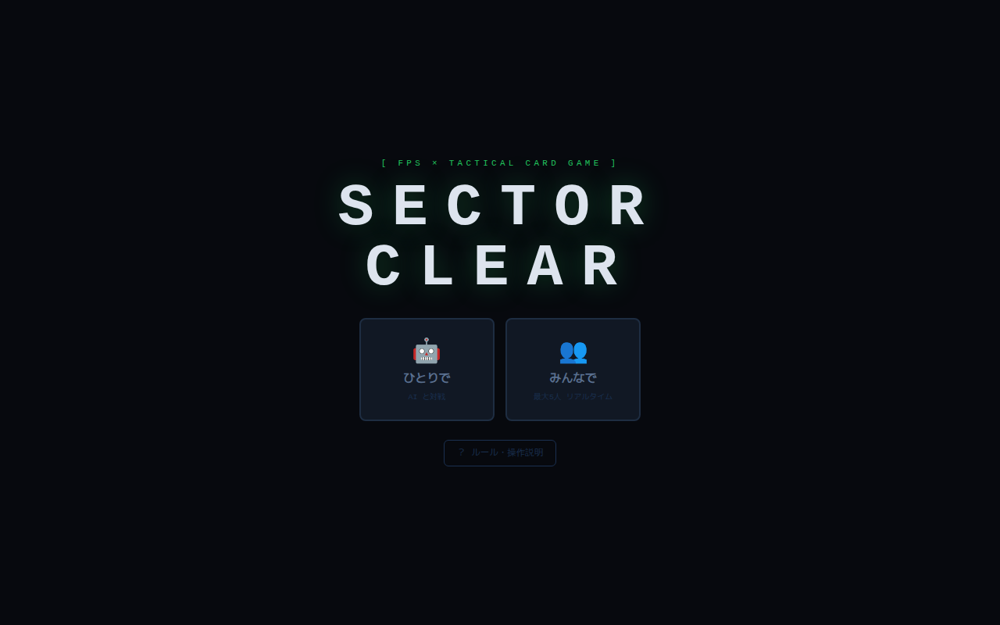
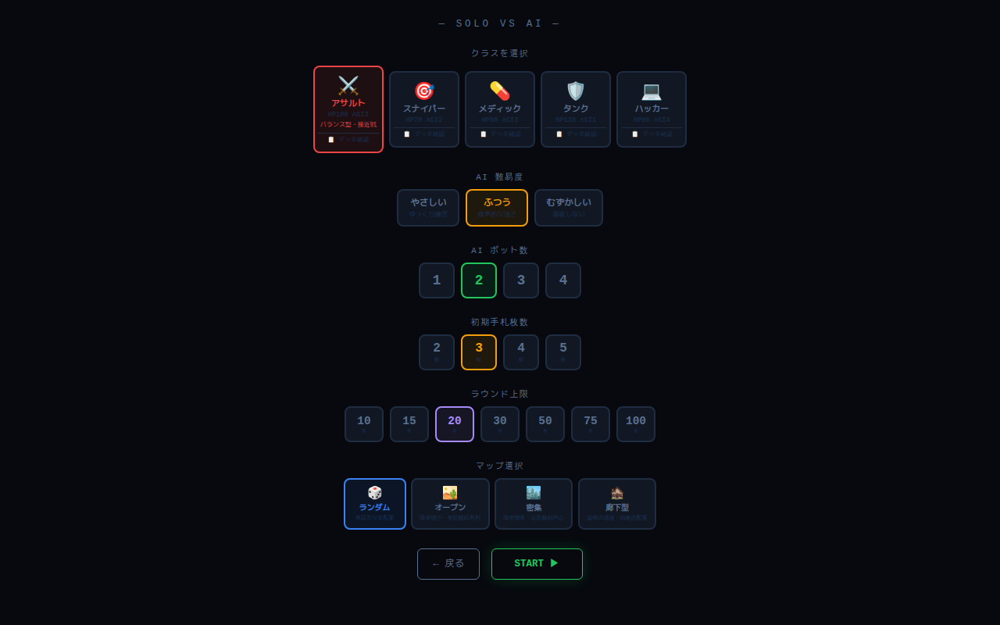
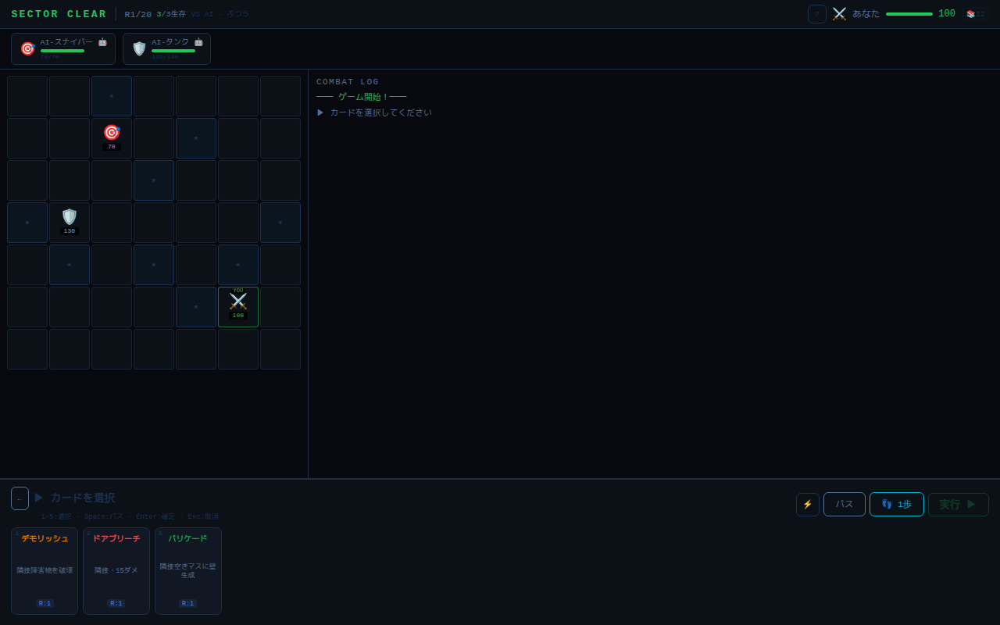
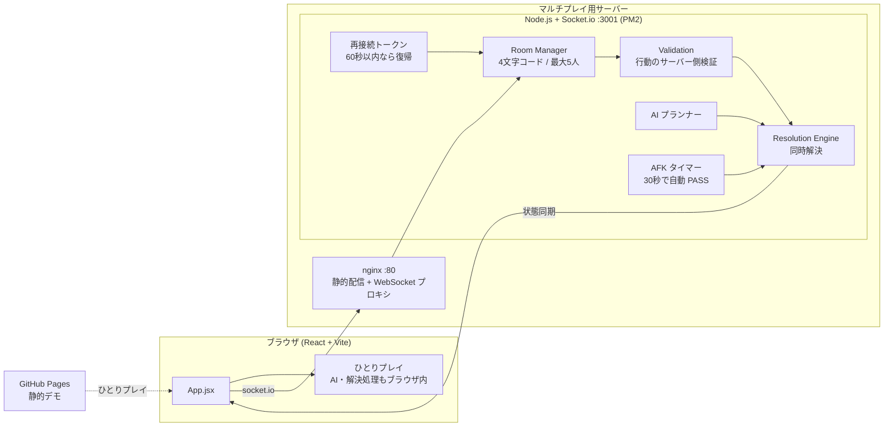

# SECTOR CLEAR — ブラウザで遊べる同時解決型ターン制タクティクス

[](https://github.com/ten-ten66/sector-clear/actions/workflows/ci.yml)

> 本プロジェクトは **Claude Code を用いたAI駆動開発** で設計・実装しました。

**▶ デモ（ひとりプレイ）: https://ten-ten66.github.io/sector-clear/**

7×7 のグリッドで、アサルト・スナイパー・メディック・タンク・ハッカーの5クラスを使い分けて戦う、カード式のターン制タクティクスゲームです。
全員が同じターンにカード（行動）を選んで送信し、そろった時点でまとめて解決する **同時解決方式** を採用しています。AI と対戦するひとりプレイと、4文字のルームコードで最大5人まで遊べるマルチプレイに対応しています。

| タイトル | 対戦設定 | 対戦画面 |
|---|---|---|
|  |  |  |

## 構成図



## 技術スタック

| 分類 | 使用技術 |
|---|---|
| フロントエンド | React 18, Vite 5, socket.io-client |
| サーバー | Node.js, Express 4, Socket.io 4 |
| インフラ | nginx（静的配信 + WebSocket リバースプロキシ）, PM2, Ubuntu VPS, GitHub Pages（デモ） |
| CI | GitHub Actions（クライアントのビルド、サーバーの構文チェック、Pages への自動デプロイ） |
| 言語 | JavaScript（JSX） |

## 主な機能

- **5つのクラス**：アサルト / スナイパー / メディック / タンク / ハッカー。HP・機動力と専用カードがそれぞれ異なる
- **同時解決のターン制**：全員が行動を確定したらまとめて解決
- **ひとりプレイ**：AI の難易度（3段階）、AI ボット数（1〜4）、初期手札（2〜5枚）、ラウンド上限（10〜100）を選べる
- **マップ**：ランダム / オープン / 密集 / 廊下型 の4種類
- **マルチプレイ**：4文字のルームコードを共有するだけで参加（最大5人）
- **AFK 対策**：30秒操作がないと自動で PASS（残り10秒・5秒で警告）
- **再接続**：切断しても60秒以内ならトークンで同じ席に復帰
- **キーボード操作**：1〜5 でカード選択 / Space でパス / Enter で確定 / Esc で取消

## 工夫した点

- **サーバー権威型のマルチプレイ**：行動の検証と解決をすべてサーバーで行い、クライアントの改ざんで結果を変えられないようにした
- **同時解決エンジン**：全員の行動を受け取ってから順序を決めて解決するので、送信の早い遅いで有利不利が出ない
- **途中離脱への強さ**：AFK の自動 PASS と再接続トークンで、1人が抜けてもゲームが止まらない
- **ひとりプレイはサーバー不要**：AI と解決処理をブラウザ内でも動かせるようにし、GitHub Pages の静的デモとして公開。デモ用ビルド（`VITE_STATIC_DEMO=1`）ではマルチプレイ画面に案内を出す
- **シンプルなデプロイ**：nginx で静的ファイルと WebSocket を1ポートにまとめ、`setup.sh` 1本で VPS に構築できる

## セットアップ

### ローカルで動かす

```bash
git clone https://github.com/ten-ten66/sector-clear.git
cd sector-clear

# サーバー（マルチプレイ用）
cd server && npm install && PORT=3001 node server.js
# 別ターミナルでクライアント（/socket.io は vite の proxy で :3001 へ転送）
cd client && npm install && npm run dev   # → http://localhost:5173
```

### VPS にデプロイ（Ubuntu）

```bash
sudo bash setup.sh     # Node.js / nginx / PM2 の導入、ビルド、nginx 設定まで実行
pm2 status             # 稼働確認
```

`setup.sh` 内のパスと `nginx.conf` の `server_name` は環境に合わせて変更してください。HTTPS 化は `certbot --nginx -d <your-domain>` で行えます。
