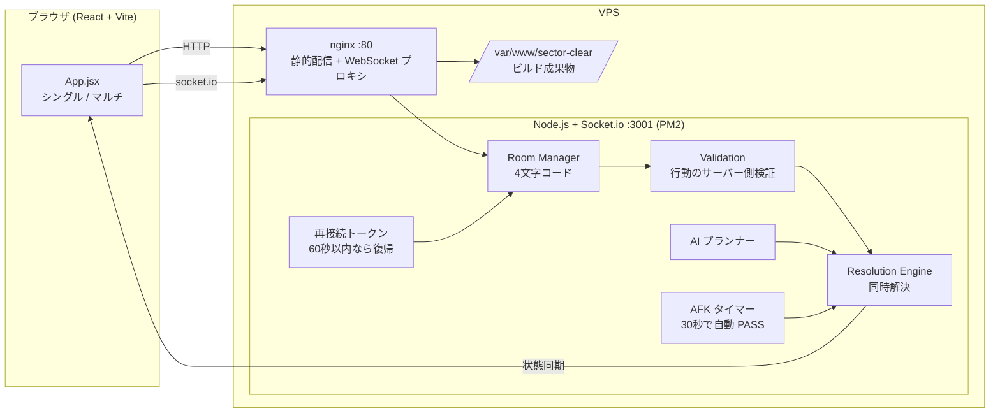

# SECTOR CLEAR — ブラウザで遊べる同時解決型ターン制タクティクス

> 本プロジェクトは **Claude Code を用いたAI駆動開発** で設計・実装しました。

グリッド上のマップで、アサルト・スナイパー・タンク・ハッカー・メディックの5ロールを使い分けて戦う、ブラウザ向けのターン制タクティクスゲームです。
全員が同じターンにカード（行動）を選んで送信し、そろった時点でサーバーがまとめて解決する **同時解決方式** を採用しています。1人プレイ（AI対戦）と、4文字のルームコードで友達と遊べるマルチプレイに対応しています。

## 構成図



## 技術スタック

| 分類 | 使用技術 |
|---|---|
| フロントエンド | React 18, Vite 5, socket.io-client |
| サーバー | Node.js 20, Express 4, Socket.io 4 |
| インフラ | nginx（静的配信 + WebSocket リバースプロキシ）, PM2, Ubuntu VPS |
| 言語 | JavaScript（JSX） |

## 主な機能

- **5つのロール**：アサルト / スナイパー / タンク / ハッカー / メディック。それぞれ専用のカードを持つ
- **同時解決のターン制**：全員が送信したらサーバーが一括で解決
- **マップ生成**：RANDOM / OPEN / DENSE の障害物配置
- **シングルプレイ**：AI 相手に遊べる
- **マルチプレイ**：4文字のルームコードを共有するだけで参加
- **AFK 対策**：30秒操作がないと自動で PASS（残り10秒・5秒で警告）
- **再接続**：切断しても60秒以内ならトークンで同じ席に復帰

## 工夫した点

- **サーバー権威型**：行動の検証と解決をすべてサーバーで行い、クライアントの改ざんで結果を変えられないようにした
- **同時解決エンジン**：全員の行動を受け取ってから順序を決めて解決するので、送信の早い遅いで有利不利が出ない
- **途中離脱への強さ**：AFK の自動 PASS と再接続トークンで、1人が抜けてもゲームが止まらない
- **シンプルなデプロイ**：nginx で静的ファイルと WebSocket を1ポートにまとめ、`setup.sh` 1本で VPS に構築できる

## セットアップ

### ローカルで動かす

```bash
git clone https://github.com/ten-ten66/sector-clear.git
cd sector-clear

# サーバー
cd server && npm install && PORT=3001 node server.js
# 別ターミナルでクライアント
cd client && npm install && npm run dev   # → http://localhost:5173
```

### VPS にデプロイ（Ubuntu）

```bash
sudo bash setup.sh     # Node.js / nginx / PM2 の導入、ビルド、nginx 設定まで実行
pm2 status             # 稼働確認
```

`setup.sh` 内のパスと `nginx.conf` の `server_name` は環境に合わせて変更してください。HTTPS 化は `certbot --nginx -d <your-domain>` で行えます。
